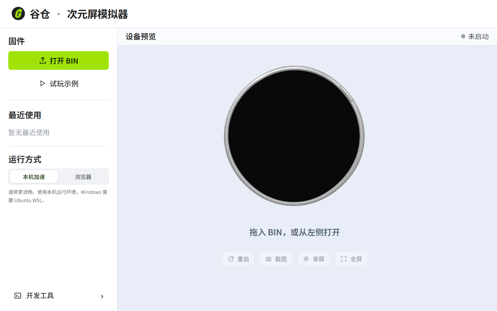
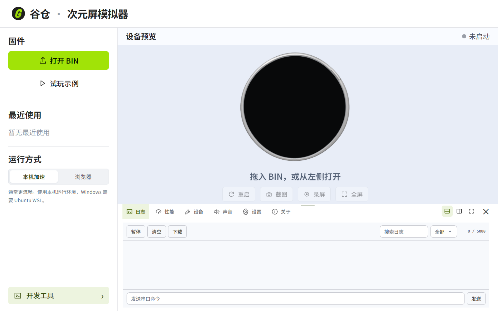

# 谷仓次元屏模拟器

在浏览器里运行 ESP32-S3 次元屏固件。支持圆屏触摸、侧键、音频、串口调试、截图和录屏。

**[打开在线模拟器](https://yeatsliao.github.io/sdgoods-simulator/)** · [使用指南](docs/USER_GUIDE.md) · [问题反馈](https://github.com/YeatsLiao/sdgoods-simulator/issues)



左侧打开 BIN 或从最近记录继续，右侧直接操作圆屏。支持整机 BIN 和兼容的 SDGOODS 纯 app 包。在线版在浏览器内运行 WASM，进度保存在当前站点。内置谷仓次元屏 Doom v1.0.0，点「试玩示例」即可离线运行。

Radio、小智等联网固件请使用本地版。固件支持手动配网时，使用虚拟 Wi-Fi `myssid`，密码 `mypassword`。公开版进展见[联网试玩](docs/ONLINE_PLAY.md)。

## 本地启动

需要 Python 3.10+ 和支持 WebGL2、AudioWorklet、IndexedDB 的浏览器。启动后打开 [http://127.0.0.1:8765/](http://127.0.0.1:8765/)。首次启动会联网下载并校验 ESP-EMU 1.1.0。

### Windows PowerShell

```powershell
git clone https://github.com/YeatsLiao/sdgoods-simulator.git
Set-Location sdgoods-simulator
python server/serve.py
```

也可以双击 `start.cmd`。本机加速需要 x86-64 和 Ubuntu WSL。

### Linux

```bash
git clone https://github.com/YeatsLiao/sdgoods-simulator.git
cd sdgoods-simulator
python3 server/serve.py
```

x86-64 Linux 支持本机加速。端口被占用时，在对应启动命令末尾加 `--port 8766`。

## 开发工具和测试



开发工具支持下方和右侧停靠。浏览器模式可在「性能」选择 1×、1.5×、2× 目标倍率，实际速度取决于电脑性能。重启保留进度，清除运行数据只重置当前固件。BLE、NFC、电池和真实硬件时序请用真机验证。

Windows PowerShell：

```powershell
node tools/run-tests.mjs
python tools/offline_realtime_check.py
```

Linux：

```bash
node tools/run-tests.mjs
python3 tools/offline_realtime_check.py
```

## 源码与第三方许可

本仓库公开源码。模拟器自身的根级许可证尚待维护者选定。第三方素材和依赖适用各自上游条款。

- [ESP-EMU 1.1.0](https://github.com/espressif/esp-emulator/releases/tag/v1.1.0) 由 Espressif 提供。
- [谷仓次元屏 Doom v1.0.0](https://github.com/YeatsLiao/sdgoods-doom/releases/tag/v1.0.0) 的 [LICENSE](web/demo/LICENSE) 和 [NOTICE](web/demo/NOTICE) 随示例分发。[平台引导文件](web/platform/README.md)另有来源说明。
- Noto Sans SC 字体子集采用 [SIL OFL 1.1](web/assets/fonts/OFL.txt)。[品牌素材](web/assets/brand/README.md)和[机身素材](web/assets/device/README.md)见各自说明。

## 文档

- [使用指南](docs/USER_GUIDE.md) · [发布与 GitHub Pages](docs/RELEASE.md) · [变更记录](CHANGELOG.md)
- [架构](docs/ARCHITECTURE.md) · [协议](docs/PROTOCOL.md) · [设计规范](DESIGN.md)
